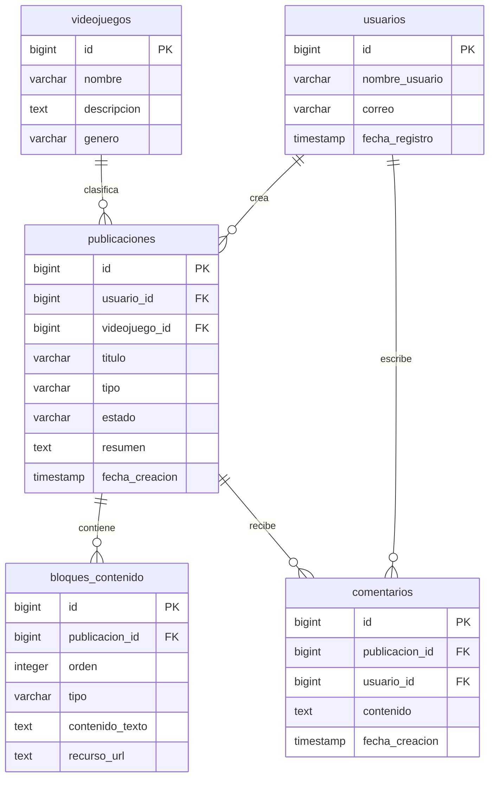

# Reporte de desarrollo con IA — r-ia-dev-s01

**Proyecto:** GameBuildArchive (repositorio `ICRURO/desarrollo-web`)  
**Integrante responsable:** Antonio  
**Fecha de la sesión documentada:** 09/11/2026  
**Número de sesión:** 01  
**Etapa:** Primera entrega — análisis y diseño  
**Archivo de trabajo:** `database/modelo-de-datos.md`  
**Herramienta utilizada:** ChatGPT (OpenAI)  
**Modelo:** GPT-6 (temperatura no disponible en la interfaz)  
**Código de uso:** Diseño / Generación / Revisión / Documentación  
**Repositorio:** https://github.com/ICRURO/desarrollo-web

## 1. Motivo de la consulta

El primer modelo contenía principalmente `videojuegos`, `elementos_jugables`, `habilidades`, `equipamiento`, `builds_guardadas` y `build_equipamiento`. El equipo aclaró que la función central sería publicar y consultar guías de videojuegos, de modo que ese diseño no representaba las necesidades prioritarias. Se solicitó apoyo de IA para replantearlo y generar un diagrama de entidades.

## 2. Prompt original

**Mensaje literal del estudiante (no reconstruido):**

> Necesito modificar el modelo de datos de GameBuildArchive, ya que actualmente está enfocado en el Build Planner, pero al presentar mi modelo de datos al equipo me hicieron saber que la función principal será una comunidad de guías y publicaciones.
>Quiero conservar las tablas anteriores, pero agregar las entidades necesarias para gestionar usuarios, publicaciones y bloques de contenido (texto e imágenes), dejando comentarios y el simulador para etapas posteriores.
>Ayúdame a definir las nuevas tablas, sus atributos, claves primarias y foráneas, relaciones y cardinalidades. También genera un diagrama entidad-relación en Mermaid y organiza el modelo por fases de desarrollo.

## 3. Respuesta de la IA
---

¡Ahora sí tenemos un cambio importante en GameBuild! 😎 Tus compañeros tienen razón: **si la funcionalidad principal será una comunidad de guías y publicaciones, el modelo de datos debe darle prioridad a esa parte, no al Build Planner.**

Pero no necesitamos desechar todo lo anterior. Podemos conservar las entidades que ya diseñamos y reorganizar el modelo según las prioridades del equipo.

### 1. Así quedaría el nuevo modelo de datos

| Tabla | Función | Prioridad |
|---|---|---|
| `usuarios` | Identificar quién crea las publicaciones | Principal |
| `videojuegos` | Clasificar las publicaciones por juego | Principal |
| `publicaciones` | Guardar guías, consejos y publicaciones | Principal |
| `bloques_contenido` | Organizar textos, imágenes y enlaces dentro de cada publicación | Principal |
| `comentarios` | Permitir interacciones entre usuarios | Segunda fase |
| `elementos_jugables` | Almacenar agentes, divisiones y personajes | Opcional |
| `habilidades` | Registrar habilidades | Opcional |
| `equipamiento` | Registrar armas y objetos | Opcional |
| `builds_guardadas` | Guardar configuraciones | Opcional |
| `build_equipamiento` | Relacionar builds con objetos | Opcional |

De esta forma, el modelo completo tendría **10 tablas propuestas**, pero para la primera implementación se pueden priorizar las cuatro principales.

### 2. La relación más importante

**Modelo principal: comunidad de publicaciones**

Los comentarios aparecen en el diseño, aunque su implementación se deja para una fase posterior.

Por ejemplo, un usuario podrá crear una guía para Zenless Zone Zero y agregar varios bloques: un título, un párrafo explicativo, una imagen y un enlace. Todo pertenecerá a una misma publicación.

**Ese será ahora el centro de GameBuild.**

### 3. Te preparé el modelo de datos actualizado

Ya adapté el documento completo para que puedas utilizarlo en tu archivo `database/modelo-de-datos.md`.

**Modelo de datos — GameBuild v2.** Markdown con 10 entidades, atributos, relaciones, reglas de negocio y dos diagramas Mermaid.

Archivo generado en la conversación: `modelo-de-datos-gamebuild-actualizado.md`.

En VS Code, sustituye el contenido de `database/modelo-de-datos.md` por el del archivo descargado. Guarda con `Ctrl + S` y comprueba los diagramas usando `Ctrl + Shift + V`.

### 4. ¿Qué hacemos con el trabajo anterior?

No borres tu base de datos de PostgreSQL. Simplemente dejamos de utilizarla como el modelo definitivo, porque todavía no incluye publicaciones ni bloques de contenido.

Para esta primera entrega:

- **Sí entregamos:** el modelo de datos actualizado con su justificación y diagramas.
- **Dejamos pendiente:** implementar las tablas nuevas, modificar `esquema.sql` y generar datos de prueba.
- **Para tu reporte de IA:** documentaremos esta decisión de rediseñar el modelo para dar prioridad a las publicaciones, ya que realmente cambió la estructura del proyecto.

Mi recomendación es que compartas este nuevo documento con tus dos compañeros para confirmar que los campos de `publicaciones` y `bloques_contenido` cumplen con los requerimientos que acordaron.

Así podremos cerrar tu aportación al **diseño inicial** sin adelantarnos nuevamente a la implementación.

---

## 4. Código o contenido generado por IA

**Tipo de código:** Mermaid, lenguaje de descripción de diagramas incluido en Markdown.  
**Resultado directo:** propuesta del diagrama de cinco entidades mostrado íntegramente en la sección 3, más un borrador de `modelo-de-datos.md` con diez tablas.  
**Archivo afectado:** `database/modelo-de-datos.md`.  

El bloque Mermaid de la sección anterior puede identificarse por su encabezado `erDiagram`. Las conexiones planteadas inicialmente fueron:

- `usuarios` 1:N `publicaciones`.
- `videojuegos` 1:N `publicaciones`.
- `publicaciones` 1:N `bloques_contenido`.
- `usuarios` 1:N `comentarios`.
- `publicaciones` 1:N `comentarios`.

## 5. Modificaciones posteriores y criterio del equipo

Después de la propuesta primera propuesta, se revisó un modelo alternativo aportado por un compañero, organizado en **13 tablas y tres fases**. El equipo llegó a los siguientes acuerdos, que **no estaban cerrados en la primera propuesta**:

1. Las publicaciones serán **públicas**; en la primera versión no se guardarán borradores ni se necesita un estado de publicación.
2. Los bloques de publicación se limitarán inicialmente a **texto e imagen**.
3. Habrá **registro e inicio de sesión** para identificar a los autores. Se guardará un hash seguro de contraseña, no su valor en texto plano.
4. Los comentarios, etiquetas, reacciones y el Build Planner quedarán documentados como ampliaciones por fases.
5. Las posibilidades de sanciones de cuenta, logros y reputación se consideran ideas futuras, no funcionalidades de la primera entrega.

**Decisión aplicada:** el modelo de datos se centra en `usuarios`, `videojuegos`, `publicaciones` y `bloques_publicacion`. El nombre `bloques_publicacion` procede de la revisión posterior del equipo, mientras que la primera propuesta de IA utilizaba `bloques_contenido`.

## 6. Prueba de funcionamiento y evidencias

Esta sesión produjo documentación de diseño y un diagrama Mermaid; **no se generó una API REST**, por lo que no corresponde fingir pruebas con `curl`.

**Prueba pertinente:** abrir `database/modelo-de-datos.md` en Visual Studio Code, guardar con `Ctrl + S` y comprobar en la vista previa de Markdown (`Ctrl + Shift + V`) que aparecen las tablas y relaciones del modelo definitivo.

**Evidencia disponible en la conversación:** se trabajó en VS Code con Markdown y se identificó un problema anterior de formato al visualizar Mermaid.  
**Prueba del modelo final:** **PENDIENTE** de adjuntar una captura que muestre el diagrama definitivo renderizado sin errores.  
**Ruta sugerida para la captura:** `documentacion/evidencias/modelo-datos-mermaid.png` (solo como ruta propuesta, no se afirma que el archivo exista).

## 7. Reflexión del estudiante

El cambio más importante fue comprender que el modelo de datos debe construirse a partir de los requerimientos principales, y no solamente de la primera idea del proyecto. La propuesta inicial estaba enfocada en personajes y equipamiento, pero el equipo decidió que la funcionalidad prioritaria es publicar guías. Utilicé la respuesta de IA como punto de partida para identificar nuevas entidades y relaciones; después contrastamos esa propuesta con el documento de un compañero y decidimos qué funciones conservar, simplificar o aplazar. Aprendí también que un diagrama Mermaid representa el diseño, pero no sustituye la implementación ni las pruebas de la base de datos.
