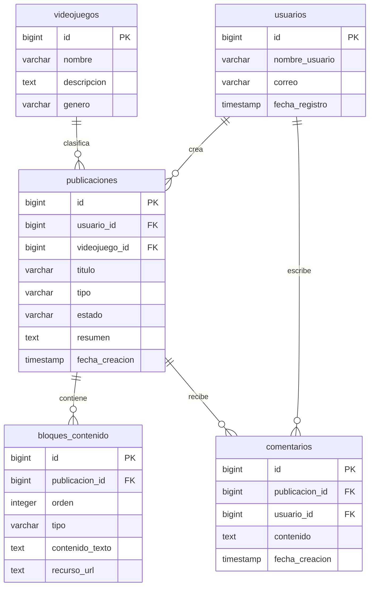

# R-IA-DOC

## Reporte 1

### Fecha

Dia 1.

### Herramienta

ChatGPT Modelo 6

### Prompt original

> Necesito modificar el modelo de datos de GameBuildArchive, ya que actualmente está enfocado en el Build Planner, pero al presentar mi modelo de datos al equipo me hicieron saber que la función principal será una comunidad de guías y publicaciones.
>Quiero conservar las tablas anteriores, pero agregar las entidades necesarias para gestionar usuarios, publicaciones y bloques de contenido (texto e imágenes), dejando comentarios y el simulador para etapas posteriores.
>Ayúdame a definir las nuevas tablas, sus atributos, claves primarias y foráneas, relaciones y cardinalidades. También genera un diagrama entidad-relación en Mermaid y organiza el modelo por fases de desarrollo.

### Respuesta de la IA

¡Ahora sí tenemos un cambio importante en GameBuild! 😎 Tus compañeros tienen razón: **si la funcionalidad principal será una comunidad de guías y publicaciones, el modelo de datos debe darle prioridad a esa parte, no al Build Planner.**

Pero no necesitamos desechar todo lo anterior. Podemos conservar las entidades que ya diseñamos y reorganizar el modelo según las prioridades del equipo.

#### 1. Así quedaría el nuevo modelo de datos

| Tabla | Función | Prioridad |
|---|---|---|
| `usuarios` | Identificar quién crea las publicaciones | Principal |
| `videojuegos` | Clasificar las publicaciones por juego | Principal |
| `publicaciones` | Guardar guías, consejos y publicaciones | Principal |
| `bloques_contenido` | Organizar textos, imágenes y enlaces dentro de cada publicación | Principal |
| `comentarios` | Permitir interacciones entre usuarios | Segunda fase |
| `elementos_jugables` | Almacenar agentes, divisiones y personajes | Opcional |
| `habilidades` | Registrar habilidades | Opcional |
| `equipamiento` | Registrar armas y objetos | Opcional |
| `builds_guardadas` | Guardar configuraciones | Opcional |
| `build_equipamiento` | Relacionar builds con objetos | Opcional |

De esta forma, el modelo completo tendría **10 tablas propuestas**, pero para la primera implementación se pueden priorizar las cuatro principales.

#### 2. La relación más importante

**Modelo principal: comunidad de publicaciones**

Los comentarios aparecen en el diseño, aunque su implementación se deja para una fase posterior.

Por ejemplo, un usuario podrá crear una guía para Zenless Zone Zero y agregar varios bloques: un título, un párrafo explicativo, una imagen y un enlace. Todo pertenecerá a una misma publicación.

**Ese será ahora el centro de GameBuild.**

#### 3. Te preparé el modelo de datos actualizado

Ya adapté el documento completo para que puedas utilizarlo en tu archivo `database/modelo-de-datos.md`.

**Modelo de datos — GameBuild v2.** Markdown con 10 entidades, atributos, relaciones, reglas de negocio y dos diagramas Mermaid.

Archivo generado en la conversación: `modelo-de-datos-gamebuild-actualizado.md`.

En VS Code, sustituye el contenido de `database/modelo-de-datos.md` por el del archivo descargado. Guarda con `Ctrl + S` y comprueba los diagramas usando `Ctrl + Shift + V`.

#### 4. ¿Qué hacemos con el trabajo anterior?

No borres tu base de datos de PostgreSQL. Simplemente dejamos de utilizarla como el modelo definitivo, porque todavía no incluye publicaciones ni bloques de contenido.

Para esta primera entrega:

- **Sí entregamos:** el modelo de datos actualizado con su justificación y diagramas.
- **Dejamos pendiente:** implementar las tablas nuevas, modificar `esquema.sql` y generar datos de prueba.
- **Para tu reporte de IA:** documentaremos esta decisión de rediseñar el modelo para dar prioridad a las publicaciones, ya que realmente cambió la estructura del proyecto.

Mi recomendación es que compartas este nuevo documento con tus dos compañeros para confirmar que los campos de `publicaciones` y `bloques_contenido` cumplen con los requerimientos que acordaron.

Así podremos cerrar tu aportación al **diseño inicial** sin adelantarnos nuevamente a la implementación.