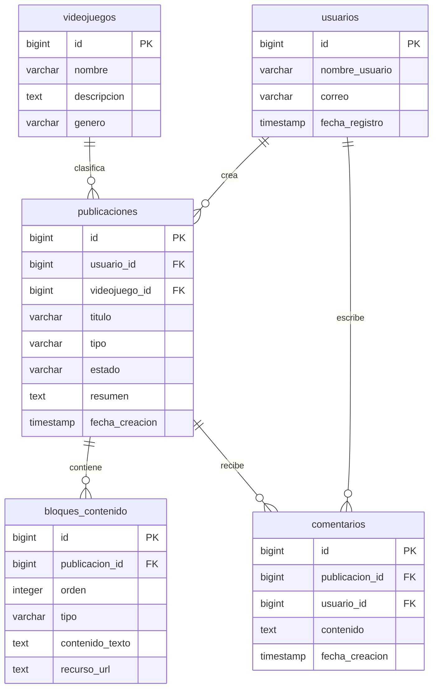

# R-IA-DOC

## Reporte 1

### Fecha

Dia 1.

### Herramienta

ChatGPT Modelo 6

### Prompt original

> Necesito modificar el modelo de datos de GameBuildArchive, ya que actualmente está enfocado en el Build Planner, pero al presentar mi modelo de datos al equipo me hicieron saber que la función principal será una comunidad de guías y publicaciones.
>Quiero conservar las tablas anteriores, pero agregar las entidades necesarias para gestionar usuarios, publicaciones y bloques de contenido (texto e imágenes), dejando comentarios y el simulador para etapas posteriores.
>Ayúdame a definir las nuevas tablas, sus atributos, claves primarias y foráneas, relaciones y cardinalidades. También genera un diagrama entidad-relación en Mermaid y organiza el modelo por fases de desarrollo.

### Respuesta de la IA

¡Ahora sí tenemos un cambio importante en GameBuild! 😎 Tus compañeros tienen razón: **si la funcionalidad principal será una comunidad de guías y publicaciones, el modelo de datos debe darle prioridad a esa parte, no al Build Planner.**

Pero no necesitamos desechar todo lo anterior. Podemos conservar las entidades que ya diseñamos y reorganizar el modelo según las prioridades del equipo.

#### 1. Así quedaría el nuevo modelo de datos

| Tabla | Función | Prioridad |
|---|---|---|
| `usuarios` | Identificar quién crea las publicaciones | Principal |
| `videojuegos` | Clasificar las publicaciones por juego | Principal |
| `publicaciones` | Guardar guías, consejos y publicaciones | Principal |
| `bloques_contenido` | Organizar textos, imágenes y enlaces dentro de cada publicación | Principal |
| `comentarios` | Permitir interacciones entre usuarios | Segunda fase |
| `elementos_jugables` | Almacenar agentes, divisiones y personajes | Opcional |
| `habilidades` | Registrar habilidades | Opcional |
| `equipamiento` | Registrar armas y objetos | Opcional |
| `builds_guardadas` | Guardar configuraciones | Opcional |
| `build_equipamiento` | Relacionar builds con objetos | Opcional |

De esta forma, el modelo completo tendría **10 tablas propuestas**, pero para la primera implementación se pueden priorizar las cuatro principales.

#### 2. La relación más importante

**Modelo principal: comunidad de publicaciones**



Los comentarios aparecen en el diseño, aunque su implementación se deja para una fase posterior.

Por ejemplo, un usuario podrá crear una guía para Zenless Zone Zero y agregar varios bloques: un título, un párrafo explicativo, una imagen y un enlace. Todo pertenecerá a una misma publicación.

**Ese será ahora el centro de GameBuild.**

#### 3. Te preparé el modelo de datos actualizado

Ya adapté el documento completo para que puedas utilizarlo en tu archivo `database/modelo-de-datos.md`.

**Modelo de datos — GameBuild v2.** Markdown con 10 entidades, atributos, relaciones, reglas de negocio y dos diagramas Mermaid.

Archivo generado en la conversación: `modelo-de-datos-gamebuild-actualizado.md`.

En VS Code, sustituye el contenido de `database/modelo-de-datos.md` por el del archivo descargado. Guarda con `Ctrl + S` y comprueba los diagramas usando `Ctrl + Shift + V`.

#### 4. ¿Qué hacemos con el trabajo anterior?

No borres tu base de datos de PostgreSQL. Simplemente dejamos de utilizarla como el modelo definitivo, porque todavía no incluye publicaciones ni bloques de contenido.

Para esta primera entrega:

- **Sí entregamos:** el modelo de datos actualizado con su justificación y diagramas.
- **Dejamos pendiente:** implementar las tablas nuevas, modificar `esquema.sql` y generar datos de prueba.
- **Para tu reporte de IA:** documentaremos esta decisión de rediseñar el modelo para dar prioridad a las publicaciones, ya que realmente cambió la estructura del proyecto.

Mi recomendación es que compartas este nuevo documento con tus dos compañeros para confirmar que los campos de `publicaciones` y `bloques_contenido` cumplen con los requerimientos que acordaron.

Así podremos cerrar tu aportación al **diseño inicial** sin adelantarnos nuevamente a la implementación.

## Reporte 2

### Fecha

Dia 4

### Herramienta

ChatGPT Modelo 6

### Prompt original

> Estoy desarrollando el backend de GameBuildArchive con Spring Boot 4.1.2 y Java 17. Utilizaremos PostgreSQL y tendremos tablas para usuarios, videojuegos, publicaciones y bloques de contenido. En clase trabajamos con clases como `Saludador`, `ISaludador` y `SaludarControlador`, pero no recuerdo haber utilizado JPA directamente. ¿Conviene agregar Spring Data JPA y `CrudRepository` en lugar de escribir todas las consultas SQL manualmente? Explícame por qué lo utilizaríamos, qué código nos ahorraría, si todavía necesitamos controladores REST y qué dependencias debo agregar al proyecto para conectarlo con PostgreSQL.

## Respuesta de la IA

Sí, **te recomiendo utilizar Spring Data JPA** para GameBuildArchive, especialmente porque el segundo entregable les pide crear entidades, repositorios y una API con GET y POST. Además, en tus prácticas ya trabajaste con varios de sus conceptos, aunque quizá no los identificabas como JPA.

#### ¿Qué es JPA y por qué lo utilizaríamos?

**JPA (Jakarta Persistence)** es una especificación que permite relacionar objetos Java con tablas de una base de datos relacional. Por ejemplo, la clase `Videojuego` puede representar la tabla `videojuegos`. Con anotaciones como `@Entity`, `@Table` e `@Id`, indicamos cómo se corresponden la clase y sus columnas.

**Hibernate** es una implementación de esa tecnología. **Spring Data JPA** facilita el acceso a los registros mediante interfaces como `CrudRepository`. Es una forma más sencilla de desarrollar las operaciones habituales de persistencia sin escribir manualmente un método SQL para cada inserción o consulta básica.

En vez de construir por nuestra cuenta consultas para guardar y buscar todos los videojuegos, podríamos definir:

```java
public interface IVideojuego extends CrudRepository<Videojuego, Long> {
}
```

A partir de esa interfaz tendremos operaciones comunes como `save()`, `findAll()`, `findById()` y `deleteById()`. **No significa que JPA haga todo automáticamente**: seguimos definiendo entidades, relaciones, validaciones y la lógica propia del proyecto.

#### ¿JPA reemplaza los controladores?

**No.** Seguiremos necesitando controladores REST para recibir solicitudes HTTP y devolver respuestas. Por ejemplo, `VideojuegoControlador` atenderá `GET /api/videojuegos` y utilizará el repositorio para consultar registros. Lo que se simplifica es el **código de acceso a datos**, no la existencia del controlador.

La organización quedaría de esta manera:

1. **Entidad:** representa una tabla, por ejemplo `Videojuego.java`.
2. **Repositorio:** contiene las operaciones de persistencia, por ejemplo `IVideojuego.java`.
3. **Controlador REST:** recibe GET/POST y utiliza el repositorio, por ejemplo `VideojuegoControlador.java`.
4. **PostgreSQL:** almacena los datos de manera persistente.

Esta estructura se parece a la que ya conoces de `Saludador.java`, `ISaludador.java` y `SaludarControlador.java`.

#### ¿Qué agregamos al proyecto?

Conserva la dependencia de Spring Web MVC y agrega estas dependencias en `<dependencies>` de `backend/pom.xml`:

```xml
<dependency>
    <groupId>org.springframework.boot</groupId>
    <artifactId>spring-boot-starter-data-jpa</artifactId>
</dependency>
<dependency>
    <groupId>org.postgresql</groupId>
    <artifactId>postgresql</artifactId>
    <scope>runtime</scope>
</dependency>
```

**Spring Data JPA** nos permitirá crear entidades y repositorios. El **driver PostgreSQL** permitirá que Java se comunique con el servidor de base de datos mediante JDBC.

Después, en `backend/src/main/resources/application.properties`, configura:

```properties
spring.application.name=backend

spring.datasource.url=jdbc:postgresql://localhost:5432/gamebuild
spring.datasource.username=gamebuild_user
spring.datasource.password=${GAMEBUILD_DB_PASSWORD}

spring.jpa.hibernate.ddl-auto=none
spring.jpa.show-sql=true
spring.jpa.open-in-view=false
```

Usamos `${GAMEBUILD_DB_PASSWORD}` para no escribir la contraseña real en un archivo que subiremos a GitHub. `ddl-auto=none` evita que Hibernate cree o modifique las tablas durante el arranque; para las tablas del modelo aprobado necesitaremos un script SQL o una estrategia de migración posterior.

Para probarlo desde WSL, inicia PostgreSQL, define la variable de entorno con tu contraseña en esa terminal y ejecuta:

```bash
sudo service postgresql start
read -r -s -p "Contraseña de PostgreSQL: " GAMEBUILD_DB_PASSWORD
echo
export GAMEBUILD_DB_PASSWORD
cd backend
./mvnw spring-boot:run
```

Si el backend inicia con los mensajes de HikariPool, el controlador JDBC, Hibernate/JPA y Tomcat, tendremos evidencia de que la **conexión** quedó configurada. Esto todavía no significa que las tablas o los endpoints GET/POST ya funcionen; esos serán los siguientes pasos.

**Recomendación:** utilicen Spring Data JPA y `CrudRepository` para reducir código repetitivo de persistencia y mantener los controladores enfocados en las peticiones HTTP. Implementen primero las entidades y repositorios de `usuarios`, `videojuegos`, `publicaciones` y `bloques_publicacion`, según el modelo aprobado por el equipo.