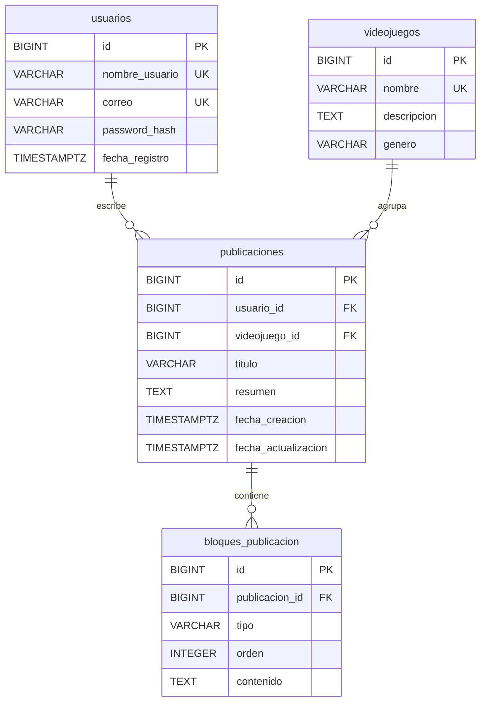
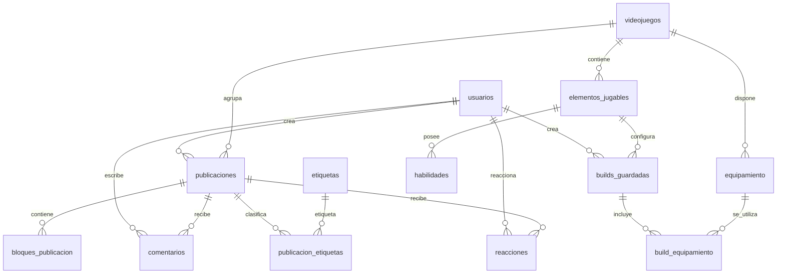

# Modelo de datos — GameBuildArchive

**Proyecto:** GameBuildArchive — Enciclopedia Interactiva y Build Planner  
**Materia:** Desarrollo Web  
**SGBD:** PostgreSQL  
**Backend previsto:** Java / Spring Boot (JPA/Hibernate)  
**Etapa:** Primera entrega — Análisis y diseño  
**Estado:** Diseño actualizado con acuerdos del equipo sobre visibilidad, bloques y autenticación; otras decisiones de implementación permanecen pendientes

## 1. Descripción y alcance

GameBuildArchive es una plataforma comunitaria para consultar, crear y compartir guías sobre videojuegos. Su primera versión contempla **Hearts of Iron IV**, **Zenless Zone Zero** y **Dying Light**. Las guías serán publicaciones **públicas** compuestas por bloques ordenados de **texto o imagen**. Cualquier visitante podrá consultarlas sin iniciar sesión; el registro e inicio de sesión serán necesarios para publicar y administrar contenido propio. En una fase posterior se contempla un simulador de configuraciones (*Build Planner*).

Este modelo parte de las seis entidades del diseño inicial del equipo (`videojuegos`, `elementos_jugables`, `habilidades`, `equipamiento`, `builds_guardadas` y `build_equipamiento`) y agrega las necesarias para cubrir la comunidad de publicaciones. **Se propone implementar por fases para evitar que el simulador retrase la función principal.**

### 1.1 Prioridades

| Fase | Objetivo | Tablas |
|---|---|---|
| **1 — MVP (prioritaria)** | Usuarios, catálogo, publicaciones y editor por bloques | `usuarios`, `videojuegos`, `publicaciones`, `bloques_publicacion` |
| **2 — Comunidad (ampliación)** | Comentarios, clasificación y reacciones | `comentarios`, `etiquetas`, `publicacion_etiquetas`, `reacciones` |
| **3 — Enciclopedia y builds (secundaria)** | Personajes/unidades, habilidades, objetos y configuraciones | `elementos_jugables`, `habilidades`, `equipamiento`, `builds_guardadas`, `build_equipamiento` |

> **Nota:** La fase indica el orden recomendado de implementación, no que todas las tablas deban estar construidas para el primer reporte. En el primer entregable se documenta el diseño y se registra su avance en GitHub.

## 2. Entidades del núcleo (fase 1)

### 2.1 `usuarios`

Almacena las cuentas de quienes publican guías. El registro y el inicio de sesión forman parte del MVP: los visitantes pueden leer publicaciones sin cuenta, pero para crear y administrar publicaciones propias se requiere una cuenta autenticada. La autenticación se implementará en el backend, sin guardar contraseñas en texto plano.

| Campo | Tipo PostgreSQL | Restricciones / significado |
|---|---|---|
| `id` | `BIGINT` | PK, identidad generada |
| `nombre_usuario` | `VARCHAR(50)` | `NOT NULL`, `UNIQUE` |
| `correo` | `VARCHAR(150)` | `NOT NULL`, `UNIQUE` |
| `password_hash` | `VARCHAR(255)` | `NOT NULL`, hash seguro |
| `fecha_registro` | `TIMESTAMPTZ` | `NOT NULL`, `DEFAULT CURRENT_TIMESTAMP` |

**Relación:** un usuario puede crear muchas publicaciones (1:N). El vínculo `publicaciones.usuario_id` identifica al autor, sin confundir visibilidad pública con autoría. Un perfil ampliado podrá añadirse posteriormente.

**Posibles ampliaciones (no incluidas en el MVP):** moderación o suspensión de cuentas, logros por contribuciones y puntuaciones de reputación. Se evaluarían con reglas y atributos o entidades adicionales en una fase futura; no se presupone que estén implementados.

### 2.2 `videojuegos`

Se conserva la entidad propuesta inicialmente por el equipo.

| Campo | Tipo PostgreSQL | Restricciones / significado |
|---|---|---|
| `id` | `BIGINT` | PK, identidad generada |
| `nombre` | `VARCHAR(100)` | `NOT NULL`, `UNIQUE` |
| `descripcion` | `TEXT` | Opcional |
| `genero` | `VARCHAR(100)` | Opcional |

**Relación:** un videojuego puede tener muchas publicaciones (1:N). Los tres títulos definidos se registrarán como datos iniciales.

### 2.3 `publicaciones`

Representa cada guía creada por la comunidad, independientemente de su videojuego. **Todas las publicaciones almacenadas son públicas**, por acuerdo del equipo; no se incorpora un campo `estado`, ni se almacenarán borradores en el MVP.

| Campo | Tipo PostgreSQL | Restricciones / significado |
|---|---|---|
| `id` | `BIGINT` | PK, identidad generada |
| `usuario_id` | `BIGINT` | FK a `usuarios(id)`, `NOT NULL` |
| `videojuego_id` | `BIGINT` | FK a `videojuegos(id)`, `NOT NULL` |
| `titulo` | `VARCHAR(180)` | `NOT NULL` |
| `resumen` | `TEXT` | Opcional, útil para tarjetas y listados |
| `fecha_creacion` | `TIMESTAMPTZ` | `NOT NULL`, `DEFAULT CURRENT_TIMESTAMP` |
| `fecha_actualizacion` | `TIMESTAMPTZ` | `NOT NULL`, `DEFAULT CURRENT_TIMESTAMP`; la aplicación debe actualizarla al editar |

**Relaciones:** cada publicación tiene **un autor** y **un videojuego**; un autor y un videojuego pueden estar asociados a muchas publicaciones.

**Regla de permisos:** cualquier visitante podrá leer una publicación y conocer su autor. Solo un usuario autenticado podrá crear publicaciones; únicamente el autor podrá editar o eliminar las suyas. Si posteriormente se incorpora un rol administrador, el backend podrá ampliar estos permisos. La autorización se comprueba en Spring Boot.

### 2.4 `bloques_publicacion`

Permite construir guías flexibles con una sucesión de bloques. Por acuerdo del equipo, **en el MVP solo se admiten los tipos `texto` e `imagen`**. No se crea una tabla distinta para cada videojuego. Los enlaces y otros bloques podrán evaluarse después.

| Campo | Tipo PostgreSQL | Restricciones / significado |
|---|---|---|
| `id` | `BIGINT` | PK, identidad generada |
| `publicacion_id` | `BIGINT` | FK a `publicaciones(id)`, `NOT NULL` |
| `tipo` | `VARCHAR(20)` | `NOT NULL`; inicialmente `texto` o `imagen` |
| `orden` | `INTEGER` | `NOT NULL`, `CHECK (orden >= 1)` |
| `contenido` | `TEXT` | `NOT NULL`; texto o ruta/URL de imagen, según `tipo` |

**Restricciones:** `UNIQUE (publicacion_id, orden)` para mantener una posición única por publicación; `CHECK (tipo IN ('texto', 'imagen'))` para la primera versión.

**Criterio de almacenamiento:** para imágenes se almacena **la referencia a un archivo** (ruta o URL), no el binario en PostgreSQL. La ubicación y el mecanismo de carga se definirán durante la implementación. El backend debe validar las referencias y el contenido.

**Regla de edición:** si se cambia el orden, el backend debe realizar la operación como una transacción que preserve la restricción de unicidad.

## 3. Entidades para interacción comunitaria (fase 2)

### 3.1 `comentarios`

| Campo | Tipo PostgreSQL | Restricciones / significado |
|---|---|---|
| `id` | `BIGINT` | PK, identidad generada |
| `publicacion_id` | `BIGINT` | FK a `publicaciones(id)`, `NOT NULL` |
| `usuario_id` | `BIGINT` | FK a `usuarios(id)`, `NOT NULL` |
| `contenido` | `TEXT` | `NOT NULL` |
| `fecha_creacion` | `TIMESTAMPTZ` | `NOT NULL`, `DEFAULT CURRENT_TIMESTAMP` |

Una publicación puede tener muchos comentarios y un usuario puede escribir muchos comentarios. Inicialmente no se contemplan respuestas anidadas.

### 3.2 `etiquetas`

| Campo | Tipo PostgreSQL | Restricciones / significado |
|---|---|---|
| `id` | `BIGINT` | PK, identidad generada |
| `nombre` | `VARCHAR(60)` | `NOT NULL`, `UNIQUE` |

### 3.3 `publicacion_etiquetas`

| Campo | Tipo PostgreSQL | Restricciones / significado |
|---|---|---|
| `publicacion_id` | `BIGINT` | FK a `publicaciones(id)`, parte de PK compuesta |
| `etiqueta_id` | `BIGINT` | FK a `etiquetas(id)`, parte de PK compuesta |

Representa la relación N:M entre publicaciones y etiquetas; la clave primaria compuesta evita duplicados.

### 3.4 `reacciones`

| Campo | Tipo PostgreSQL | Restricciones / significado |
|---|---|---|
| `usuario_id` | `BIGINT` | FK a `usuarios(id)`, parte de PK compuesta |
| `publicacion_id` | `BIGINT` | FK a `publicaciones(id)`, parte de PK compuesta |
| `fecha_creacion` | `TIMESTAMPTZ` | `NOT NULL`, `DEFAULT CURRENT_TIMESTAMP` |

En esta versión una reacción equivale a un **Me gusta**. La clave compuesta evita más de un Me gusta por usuario y publicación.

## 4. Entidades de enciclopedia y simulador (fase 3)

Se conservan las seis tablas originalmente propuestas. Estas tablas **no sustituyen** a `publicaciones` ni a sus bloques; representan información estructurada para consultas y builds.

### 4.1 `elementos_jugables`

| Campo | Tipo PostgreSQL | Restricciones / significado |
|---|---|---|
| `id` | `BIGINT` | PK, identidad generada |
| `videojuego_id` | `BIGINT` | FK a `videojuegos(id)`, `NOT NULL` |
| `nombre` | `VARCHAR(100)` | `NOT NULL` |
| `tipo` | `VARCHAR(50)` | `NOT NULL`; agente, división, superviviente, etc. |
| `descripcion` | `TEXT` | Opcional |

### 4.2 `habilidades`

| Campo | Tipo PostgreSQL | Restricciones / significado |
|---|---|---|
| `id` | `BIGINT` | PK, identidad generada |
| `elemento_id` | `BIGINT` | FK a `elementos_jugables(id)`, `NOT NULL` |
| `nombre` | `VARCHAR(100)` | `NOT NULL` |
| `descripcion` | `TEXT` | Opcional |
| `tipo` | `VARCHAR(50)` | Opcional |
| `bonificacion` | `NUMERIC(10,2)` | `NOT NULL`, `DEFAULT 0`; cálculo simplificado pendiente de especificar |

### 4.3 `equipamiento`

| Campo | Tipo PostgreSQL | Restricciones / significado |
|---|---|---|
| `id` | `BIGINT` | PK, identidad generada |
| `videojuego_id` | `BIGINT` | FK a `videojuegos(id)`, `NOT NULL` |
| `nombre` | `VARCHAR(100)` | `NOT NULL` |
| `tipo` | `VARCHAR(50)` | Opcional |
| `descripcion` | `TEXT` | Opcional |
| `bonificacion` | `NUMERIC(10,2)` | `NOT NULL`, `DEFAULT 0`; cálculo simplificado pendiente de especificar |

### 4.4 `builds_guardadas`

| Campo | Tipo PostgreSQL | Restricciones / significado |
|---|---|---|
| `id` | `BIGINT` | PK, identidad generada |
| `usuario_id` | `BIGINT` | FK a `usuarios(id)`, `NOT NULL`; **añadido** para identificar al creador |
| `elemento_id` | `BIGINT` | FK a `elementos_jugables(id)`, `NOT NULL` |
| `nombre` | `VARCHAR(100)` | `NOT NULL` |
| `descripcion` | `TEXT` | Opcional |
| `nivel` | `INTEGER` | `NOT NULL`, `DEFAULT 1`, `CHECK (nivel >= 1)` |
| `fecha_creacion` | `TIMESTAMPTZ` | `NOT NULL`, `DEFAULT CURRENT_TIMESTAMP` |

### 4.5 `build_equipamiento`

| Campo | Tipo PostgreSQL | Restricciones / significado |
|---|---|---|
| `id` | `BIGINT` | PK, identidad generada |
| `build_id` | `BIGINT` | FK a `builds_guardadas(id)`, `NOT NULL` |
| `equipamiento_id` | `BIGINT` | FK a `equipamiento(id)`, `NOT NULL` |

**Restricción:** `UNIQUE (build_id, equipamiento_id)`; una build puede tener múltiples equipos y cada equipo puede aparecer en distintas builds.

**Regla de compatibilidad heredada:** el equipamiento asignado debe pertenecer al mismo videojuego que el elemento jugable de la build. Esto se debe validar en la lógica del backend porque no queda garantizado por estas claves foráneas.

**Limitación reconocida:** los campos `bonificacion` representan una aproximación simplificada y aún no permiten expresar múltiples estadísticas, ranuras, cantidades o restricciones específicas por videojuego. Si se implementa el simulador, el equipo deberá definir primero sus cálculos y reglas reales.

## 5. Diagrama entidad-relación — núcleo (fase 1)

## 6. Diagrama entidad-relación — ampliaciones (fases 2 y 3)

## 7. Reglas de negocio y decisiones técnicas

1. Las publicaciones deben tener autor, videojuego y título; todas las publicaciones persistidas son públicas, sin borradores guardados en el MVP.
2. Al crear una publicación, el backend debe exigir al menos un bloque válido de `texto` o `imagen` y guardar la publicación y sus bloques en una misma transacción. Un formulario puede mantenerse sin guardar mientras el usuario lo edita en el navegador.
3. Los bloques se muestran según `orden`, de menor a mayor.
4. El registro e inicio de sesión forman parte del MVP. Solo los usuarios autenticados pueden crear publicaciones; editar y eliminar queda reservado al autor. El backend verifica la identidad y la autoría.
5. Cualquier visitante, con o sin sesión, puede consultar el catálogo, las publicaciones públicas y el nombre del autor. No se admiten publicaciones privadas ni borradores almacenados. El editor solo admite bloques `texto` e `imagen`.
6. Las contraseñas no se almacenan en texto plano: solo se guarda un hash generado por el mecanismo de autenticación.
7. Un usuario solo puede dar un Me gusta por publicación (cuando se implemente la fase 2).
8. Las etiquetas no pueden repetirse en la misma publicación (cuando se implemente la fase 2).
9. En las builds, cada elemento jugable pertenece a un videojuego; el equipamiento seleccionado debe pertenecer al mismo juego.
10. Las fechas de creación se generan en el servidor; las fechas de edición se actualizan al modificar un registro.
11. Se deberá definir la política de eliminación: por ejemplo, eliminar bloques/comentarios/reacciones asociados al borrar una publicación; para usuarios con publicaciones se recomienda inicialmente **restringir** la eliminación hasta definir una política de conservación.
12. PostgreSQL debe aplicar claves foráneas y restricciones; Spring Boot se encarga de validaciones de datos, autenticación y autorización.
13. La relación entre publicación y usuario permitirá ampliar en el futuro funciones de moderación de cuentas, logros y reputación, sin comprometer su implementación en la primera versión.

## 8. Relación con requerimientos funcionales

| Requerimientos planteados | Tablas principales | Fase |
|---|---|---|
| RF-01–RF-02: registro e inicio/cierre de sesión | `usuarios` + lógica de autenticación | 1 |
| RF-03–RF-04: consulta y edición de perfil | `usuarios`; ampliar atributos si es necesario | 1 / posterior |
| RF-05–RF-07: catálogo, filtro por juego y búsqueda | `videojuegos`, `publicaciones` + consultas | 1 |
| RF-08–RF-14: ver, crear, editar, borrar y visualizar guías por bloques | `publicaciones`, `bloques_publicacion`, `usuarios`, `videojuegos` | 1 |
| RF-15–RF-16: búsqueda y categorías/etiquetas | `publicaciones`, `etiquetas`, `publicacion_etiquetas` | 1 / 2 |
| RF-17–RF-20: comentarios, Me gusta y publicaciones por autor | `comentarios`, `reacciones`, `publicaciones`, `usuarios` | 2 (listado por autor posible desde 1) |
| RF-21–RF-23: simulador y builds guardadas | seis tablas del modelo original + `usuarios` | 3 |

> La presencia de una tabla **no implementa** por sí sola un requisito: también deben desarrollarse servicios, endpoints REST, validación, interfaz y pruebas.

## 9. Ejemplo de una publicación

**Publicación:** «Build de Ellen Joe»  
**Juego:** Zenless Zone Zero  
**Autor:** usuario registrado

Bloques ordenados de ejemplo:

| `orden` | `tipo` | `contenido` (ejemplo) |
|---:|---|---|
| 1 | `texto` | Introducción y propósito de la guía |
| 2 | `imagen` | Ruta o URL de una imagen de referencia |
| 3 | `texto` | Discos, motor W y equipos recomendados |

De la misma manera, una guía de Hearts of Iron IV puede incluir estrategias de campaña y capturas de pantalla, y una guía de Dying Light puede explicar rutas, equipo y consejos, **sin cambiar la estructura de la base de datos**.

## 10. Preparación para implementación

- **Primera entrega:** revisar requerimientos, confirmar el modelo, conservar este documento y el diagrama como evidencias de diseño.
- **Backend inicial:** crear entidades JPA para la fase 1, repositorios y endpoints REST; comprobar consultas con `curl` desde WSL.
- **Base de datos:** escribir el esquema SQL o generar tablas mediante migraciones controladas; registrar la configuración requerida sin subir contraseñas a GitHub.
- **Frontend:** consumir los endpoints mediante `fetch` para listar guías y crear publicaciones.
- **Trabajo colaborativo:** conservar commits de cada integrante y relacionarlos en `r-act-1.md`.

### Decisiones pendientes de validación con el equipo

- Definir el mecanismo de almacenamiento y carga de imágenes.
- Confirmar las operaciones de edición de bloques (reemplazar todos o editar individualmente).
- Confirmar si los comentarios y etiquetas entrarán en la primera versión o en una ampliación.
- Definir, solo si se plantean en entregas posteriores, políticas de moderación, logros y reputación por contribuciones.
- Definir las estadísticas y reglas específicas antes de programar simuladores de builds.

---

**Resumen:** La propuesta mantiene las seis tablas del módulo de builds diseñadas originalmente por el equipo, pero incorpora primero la estructura necesaria para una comunidad de publicaciones públicas con autor identificado, autenticación para publicar y bloques de texto e imagen. Moderación, logros, reputación y simulador se reservan para posibles ampliaciones.
